# Inheritance (Pewarisan)
<h4>Nama: Muhammad Hafiz<h4>
<h4>NIM: 254107020056 <h4>
<h4>Kelas: TI - 2G <h4>

## Percobaan 1: Single Inheritance dengan extends (ClassA dan ClassB)
> 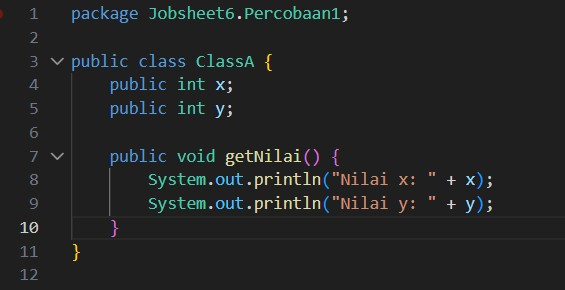
> 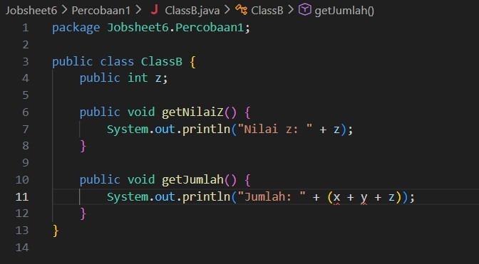
> 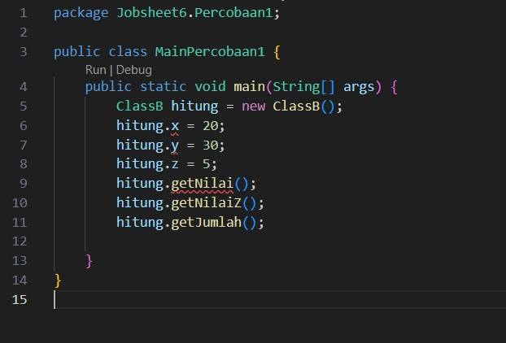
Kompilasi program (atau lihat garis merah di VSCode). Kompilasi gagal, dan itu memang
diharapkan pada langkah ini.

> 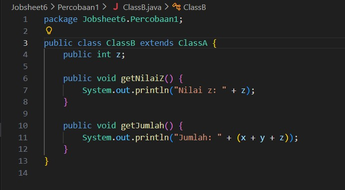
> 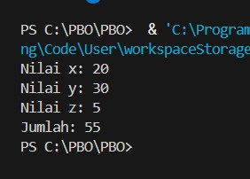

## Percobaan 2: Hak Akses pada Pewarisan (private dan protected)
> 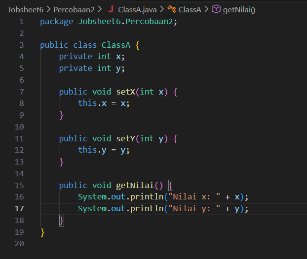
> 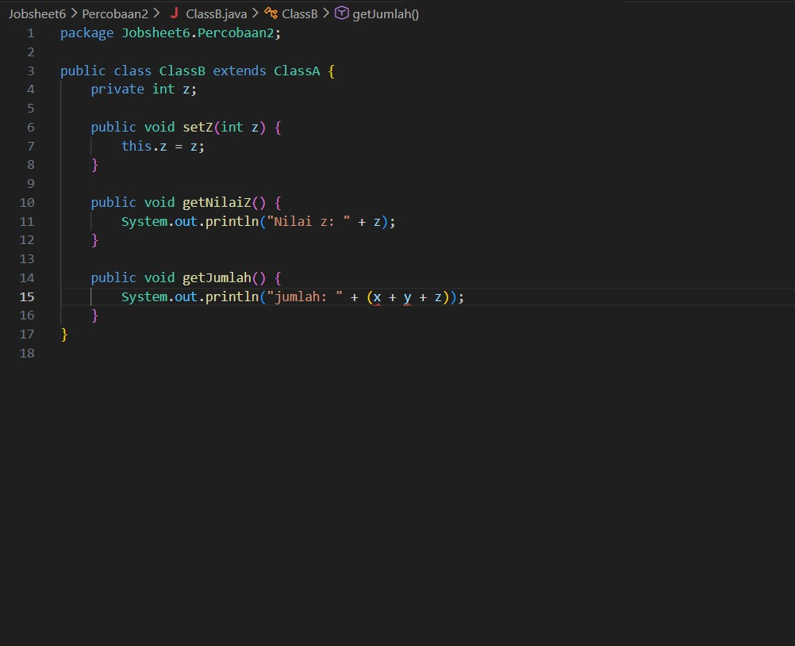
> 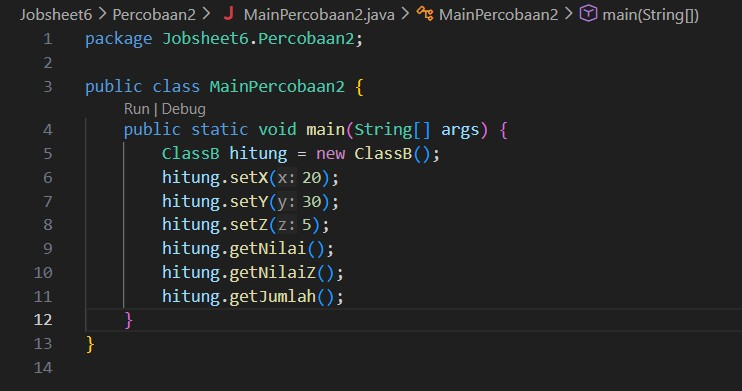
> 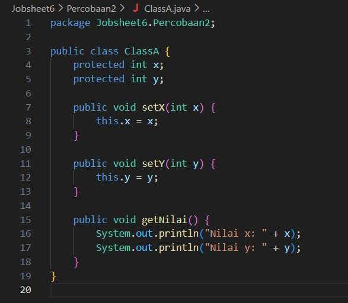
> 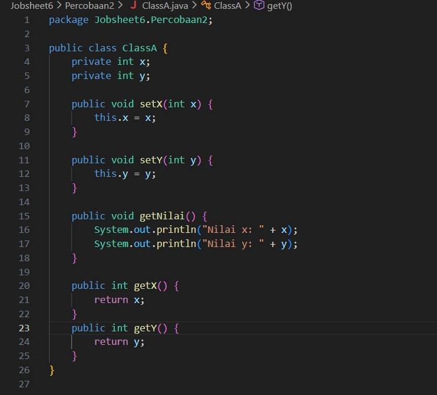 
Kompilasi program. Kompilasi gagal, dan itu memang diharapkan pada langkah ini

> 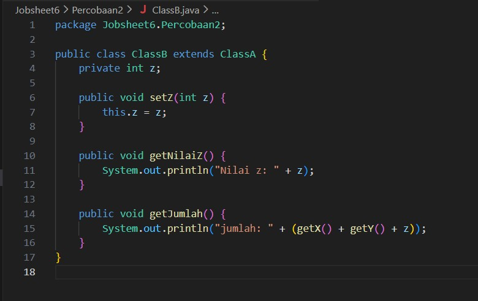
✅ Checkpoint: kompilasi berhasil dan output menampilkan
nilai x: 20, nilai y: 30, nilai z: 5 dan jumlah: 55.

> 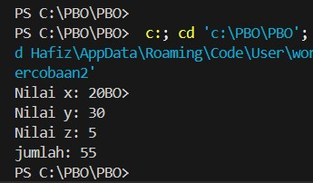
✅ Checkpoint: output sama persis dengan Perbaikan A (jumlah: 55), tetapi atribut x dan y tetap tersembunyi dari class lain.

### Pertanyaan
1. Di file dan baris mana error pada Langkah 5 muncul, dan apa pesannya? Mengapa error tidak muncul di MainPercobaan2?
2. Jelaskan penyebab error tersebut dengan merujuk pada tabel kontrol pengaksesan (Langkah 1).
3. Pada kode awal, MainPercobaan2 memanggil hitung.setX(20) dan tidak error, padahal x bersifat private. Mengapa pemanggilan ini diperbolehkan, dan di mana nilai x tersimpan?
4. Bandingkan Perbaikan A (protected) dan Perbaikan B (private + getter) dari sisi encapsulation. Mana yang Anda pilih untuk program sungguhan? Jelaskan alasannya.
5. Andaikan ClassA dan ClassB berada di package yang berbeda. Berdasarkan tabel, apakah ClassB tetap dapat mengakses atribut protected milik ClassA? Bagaimana jika atributnya default (tanpa modifier)?

### Jawaban
1. Error muncul di file ClassB.java baris 15 dengan pesan x has private access in ClassA dan y has private access in ClassA. Error tidak muncul di MainPercobaan2 karena class tersebut hanya memanggil method ber-modifier public.
2. Atribut ber-modifier private hanya dapat diakses langsung oleh class yang menyatakannya (ClassA), sehingga subclass (ClassB) tidak memiliki akses langsung.
3. Pemanggilan diperbolehkan karena method setX() ber-modifier public, dan nilai 20 tersebut tersimpan di dalam atribut private x milik superclass (ClassA).
4. Perbaikan B (private + getter) lebih disarankan karena menjaga prinsip enkapsulasi/penyembunyian data (data hiding), sehingga akses terhadap variabel tetap terkontrol secara aman.
5. Untuk modifier protected, ClassB yang berada di package berbeda tetap dapat mengaksesnya karena berstatus subclass. Jika atribut ber-modifier default (tanpa modifier), ClassB tidak akan dapat mengaksesnya.

## Percobaan 3: Kata Kunci this dan super (Bangun dan Tabung)
> 
> 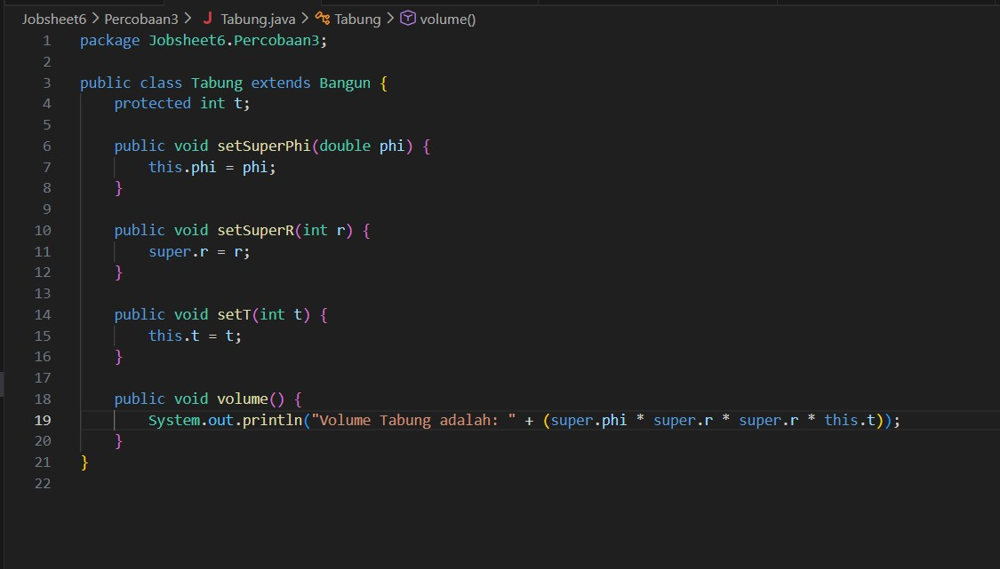
> 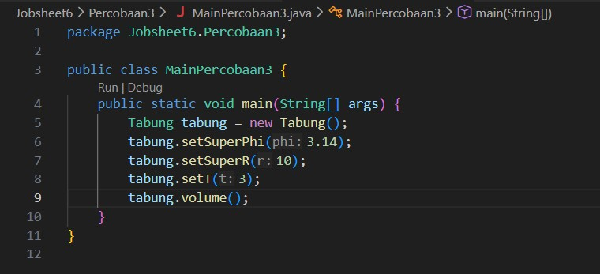
> 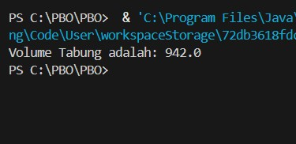
✅ Checkpoint: output menampilkan Volume Tabung adalah: 942.0 (= 3,14 × 10 × 10 × 3).

> 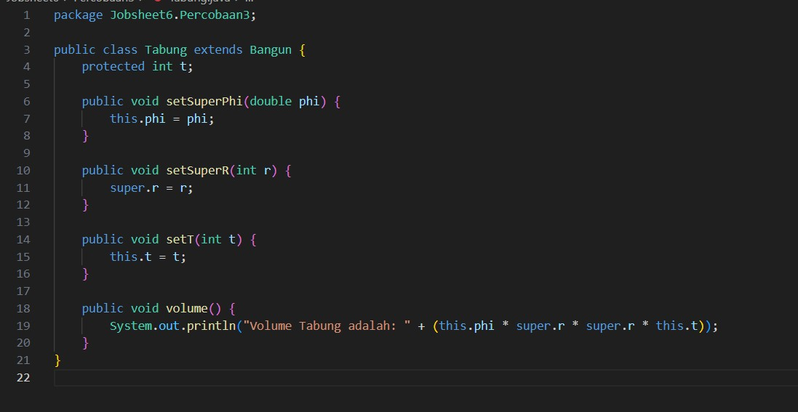
✅ Checkpoint: output tetap Volume Tabung adalah: 942.0

> 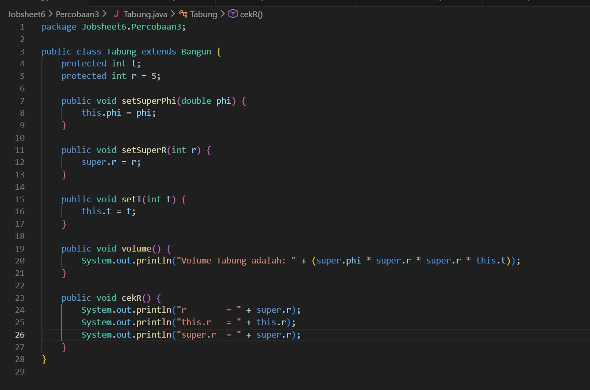
> 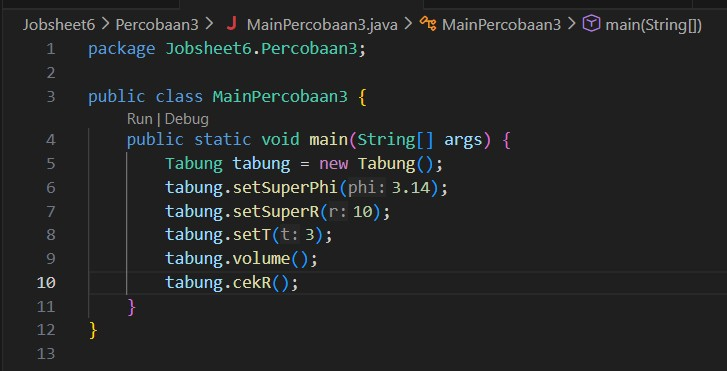
> 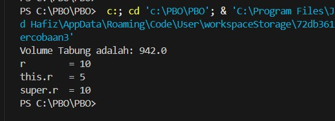
✅ Checkpoint: setelah baris volume, muncul tiga baris: r = 5, this.r = 5, dan super.r = 10.

### Pertanyaan
1. Jelaskan fungsi super pada super.phi = phi; dan super.r = r; di method setSuperPhi() dan setSuperR() milik Tabung.
2. Jelaskan fungsi super dan this pada ekspresi super.phi * super.r * super.r * this.t di method volume().
3. Mengapa Tabung tidak mendeklarasikan atribut phi dan r, tetapi tetap dapat mengaksesnya? Apa yang terjadi bila pada Bangun keduanya diubah menjadi private?
4. Pada Eksperimen 1, apakah output berubah ketika super.phi diganti this.phi? Jelaskan mengapa.
5. Pada Eksperimen 2, mengapa r, this.r, dan super.r menghasilkan nilai yang berbeda? Pada kondisi apa awalan super. menjadi wajib dipakai?

### Jawaban
1. Kata kunci super berfungsi untuk merujuk dan mengisi atribut phi serta r yang merupakan milik superclass (Bangun).
2. super merujuk ke atribut phi dan r milik superclass (Bangun), sedangkan this merujuk ke atribut t milik class itu sendiri (Tabung).
3. Tabung dapat mengaksesnya karena mewarisi atribut ber-modifier protected dari Bangun. Jika diubah menjadi private, Tabung tidak dapat mengaksesnya dan akan menghasilkan error kompilasi.
4. Output tidak berubah karena atribut phi diwarisi dari Bangun dan tidak ada deklarasi ulang atribut phi di dalam Tabung.
5. r dan this.r bernilai 5 karena merujuk ke atribut r milik Tabung, sedangkan super.r bernilai 10 karena merujuk ke atribut r milik Bangun. Awalan super wajib digunakan saat terjadi variable shadowing (nama atribut di subclass sama dengan superclass).

## Konstruktor dan Multilevel Inheritance (ClassA, ClassB, ClassC)
> 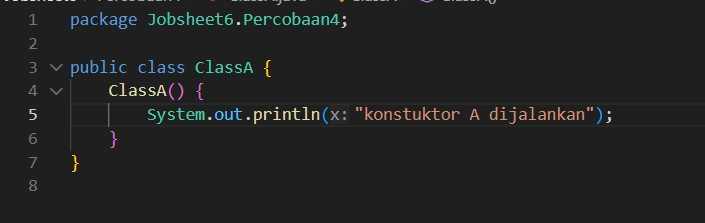
> 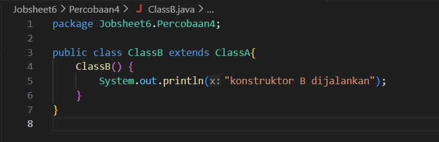
> 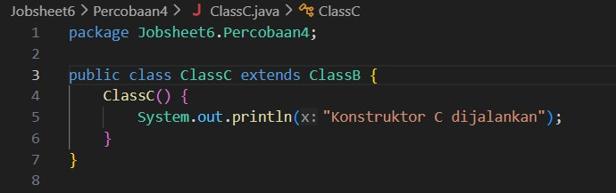
> 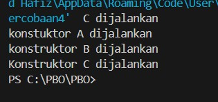
✅ Checkpoint: output menampilkan tiga baris berurutan:
konstruktor A dijalankan, konstruktor B dijalankan, lalu konstruktor C dijalankan.

> 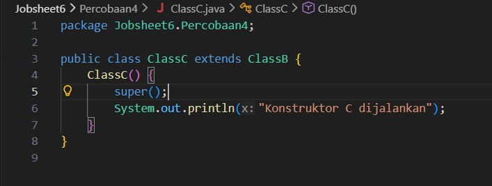
✅ Checkpoint: output identik dengan Langkah 3

> 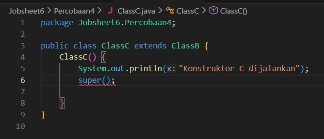
📘 Catatan Konsep: Kompilasi gagal dengan pesan call to super must be first statement in constructor pada ClassC.java baris 6. Pemanggilan super(...) wajib menjadi baris pertama di dalam konstruktor subclass.

### Pertanyaan
1. Sebutkan class yang berperan sebagai superclass dan subclass pada percobaan ini beserta alasannya. Mengapa ClassB disebut berperan ganda?
2. Program hanya membuat satu objek (new ClassC()), tetapi tiga baris tercetak. Jelaskan mengapa konstruktor ClassA dan ClassB ikut dijalankan.
3. Pada Modifikasi 1, mengapa output tidak berbeda dari sebelumnya meskipun super(); ditambahkan secara eksplisit?
4. Pada Modifikasi 2 terjadi error. Aturan apa yang dilanggar, dan mengapa Java menetapkan aturan tersebut?
5. Tuliskan urutan proses (bernomor) yang terjadi ketika new ClassC() dieksekusi, dimulai dari pemanggilan konstruktor ClassC hingga seluruh output tercetak.

### Jawaban
1. ClassA adalah superclass dari ClassB. ClassB adalah subclass dari ClassA sekaligus superclass dari ClassC. ClassB berperan ganda karena berada di tengah hierarki multilevel inheritance.
2. Ketika objek subclass dibuat, Java secara otomatis mengeksekusi konstruktor superclass terlebih dahulu dari tingkat teratas hingga ke bawah.
3. Output sama karena kompilator Java secara implisit selalu menyisipkan pemanggilan super() pada baris pertama konstruktor jika tidak ditulis.
4. Melanggar aturan bahwa super() wajib diletakkan pada baris pertama konstruktor. Aturan ini diterapkan agar bagian superclass diinisialisasi sepenuhnya sebelum subclass memproses kodenya.
5. Urutan prosesnya: Executing new ClassC() memanggil konstruktor ClassC(). ClassC() memanggil super() ke konstruktor ClassB().   ClassB() memanggil super() ke konstruktor ClassA(). Konstruktor ClassA() selesai dieksekusi dan mencetak "konstruktor A dijalankan". Konstruktor ClassB() selesai dieksekusi dan mencetak "konstruktor B dijalankan". Konstruktor ClassC() selesai dieksekusi dan mencetak "konstruktor C dijalankan".

## Percobaan 5: Konstruktor Berparameter dan Overriding (Komputer, Desktop, Laptop)
> 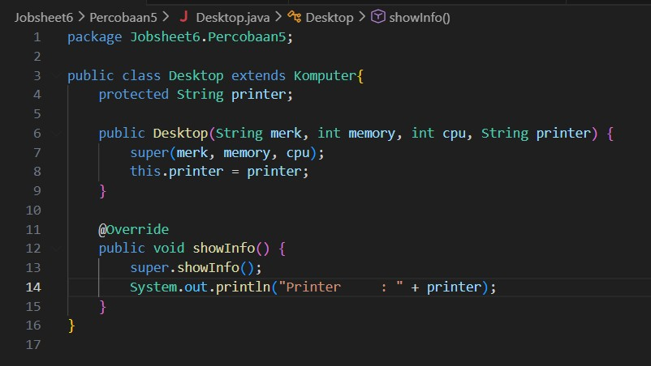
> 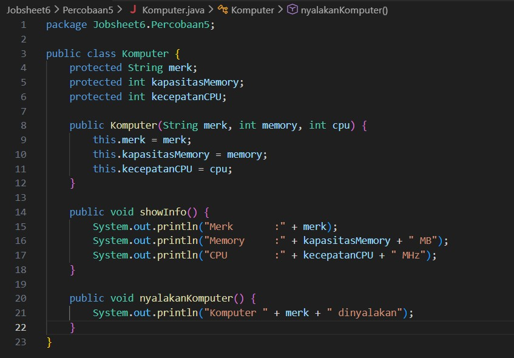
> 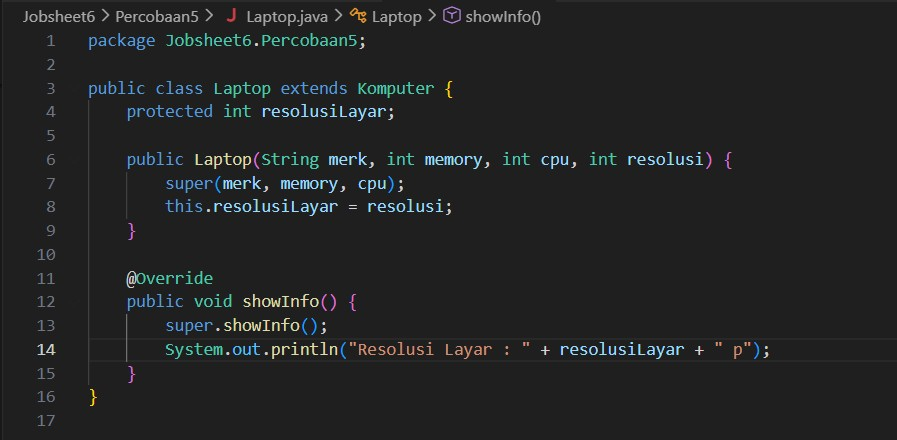
> 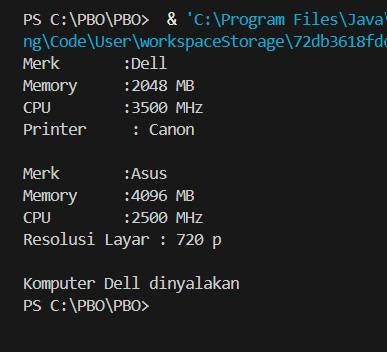
✅ Checkpoint: output menampilkan data Desktop (Merk : Dell hingga Printer : Canon), data Laptop (Merk : Asus hingga Resolusi Layar : 720p), lalu Komputer Dell dinyalakan.
> 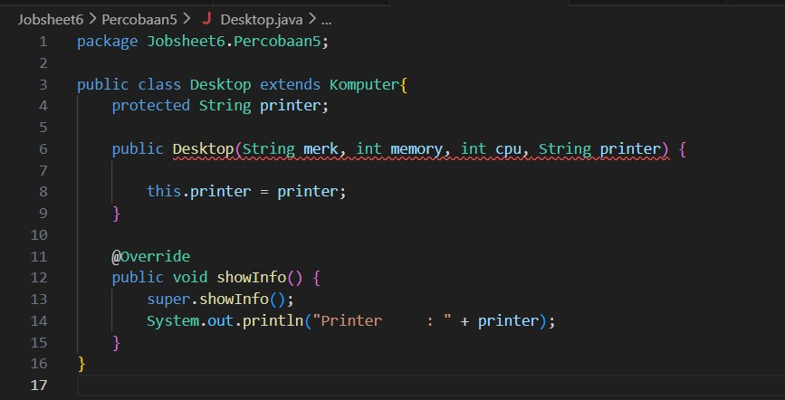
📘 Catatan Konsep: Kompilasi gagal pada Desktop.java baris 6 dengan pesan constructor Komputer in class Komputer cannot be applied to given types (required: String,int,int, found: no arguments). Tanpa super(...), compiler menyisipkan super(); otomatis, tetapi Komputer tidak memiliki konstruktor tanpa parameter.
> 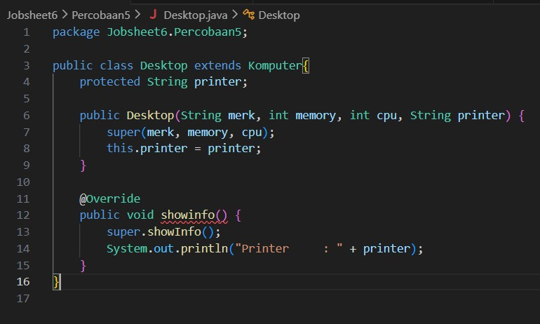
📘Catatan Konsep: Dengan @Override, compiler menolak kode dengan pesan method does not override or implement a method from a supertype. Tanpa @Override, kompilasi lolos, tetapi showinfo() hanya menjadi method baru, sehingga desk.showInfo() memanggil versi Komputer dan baris Printer tidak tercetak.

### Pertanyaan
1. Jelaskan fungsi super(merk, memory, cpu) pada konstruktor Desktop. Atribut apa saja yang diisi oleh baris tersebut, dan atribut apa yang diisi oleh baris berikutnya?
2. Pada Eksperimen 1, mengapa error muncul di sini, padahal pada Percobaan 4 super() juga tidak ditulis tetapi program tetap berjalan?
3. Method showInfo() ditulis di Komputer sekaligus di Desktop. Apa istilah untuk kondisi ini? Apa yang tercetak bila baris super.showInfo(); pada Desktop dihapus?
4. Pada Eksperimen 2, jelaskan perbedaan hasil kompilasi dengan dan tanpa @Override. Apa manfaat menuliskan @Override?
5. Tantangan. Buat class Workstation sebagai turunan Desktop dengan atribut gpu (String). Class ini harus menimpa showInfo() sehingga menampilkan seluruh informasi Desktop ditambah baris GPU. Ketika new Workstation(...) dibuat, konstruktor class apa saja yang terpanggil, dan dalam urutan apa?

### Jawaban
1. super(merk, memory, cpu) memanggil konstruktor superclass (Komputer) untuk menginisialisasi atribut merk, kapasitasMemory, dan kecepatanCPU, sedangkan baris berikutnya menginisialisasi atribut printer milik Desktop.
2. Error muncul karena class Komputer tidak menyediakan konstruktor default tanpa parameter, sehingga pemanggilan super() otomatis gagal.
3. Istilah kondisi ini adalah method overriding. Jika super.showInfo() dihapus, informasi dasar komputer tidak akan tercetak dan hanya menampilkan baris Printer : Canon.
4. Dengan @Override, kompilator akan memberikan error jika terjadi kesalahan penulisan nama/signature method. Tanpa @Override, kesalahan penulisan dianggap sebagai method baru biasa dan tidak menimpa method superclass. Manfaatnya adalah mencegah human error saat penulisan overriding.
5. Saat new Workstation(...) dibuat, konstruktor yang dipanggil secara berurutan adalah: Komputer -> Desktop -> Workstation.