# Overloading dan Overriding
<h4>Nama: Muhammad Hafiz<h4>
<h4>NIM: 254107020056 <h4>
<h4>Kelas: TI - 2G <h4>

## Percobaan 1
> 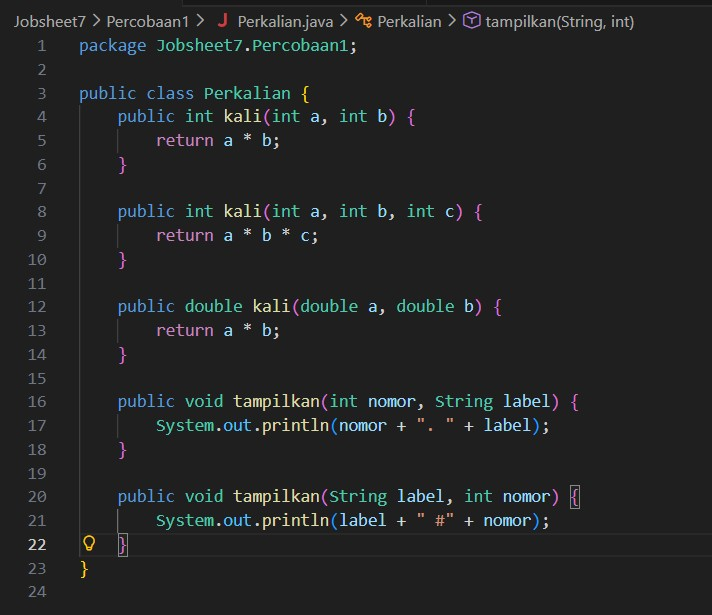
> 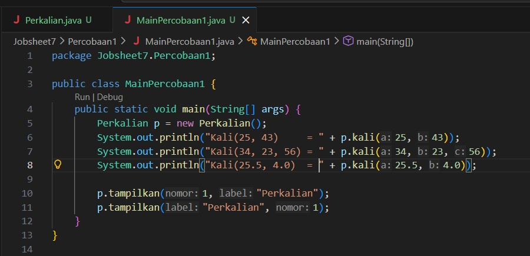
> 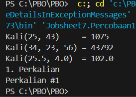

Tambahan pada class Perkalian:
- public long kali(int a, int b) { return (long) a * b; } --> Duplicate method kali(int, int) in type Perkalian
- public int kali(int x, int y) { return x * y; } --> Duplicate method kali(int, int) in type Perkalian
- p.kali(5, 2.5), p.kali(2, 3), p.kali (2.0,3) --> Kali(5, 2.5) = 12.5, Kali(2, 3) = 6, Kali(2.0, 3.0)   = 6.0

## Percobaan 2
> 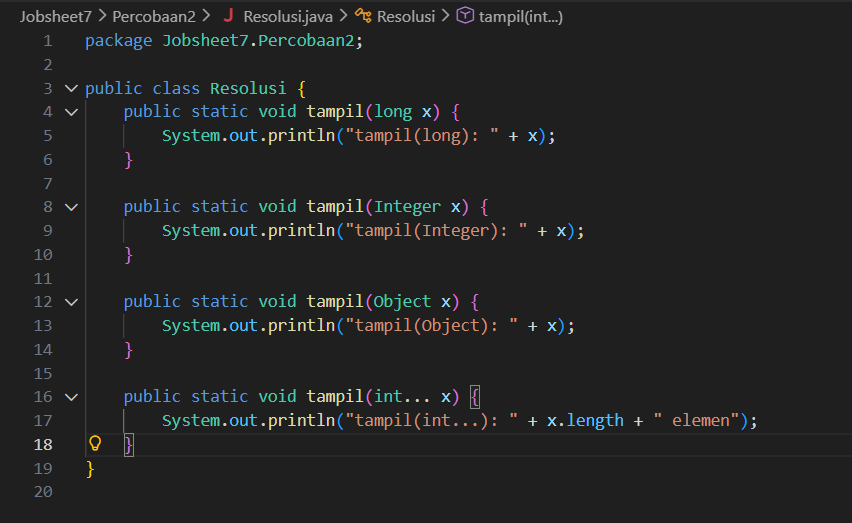
> 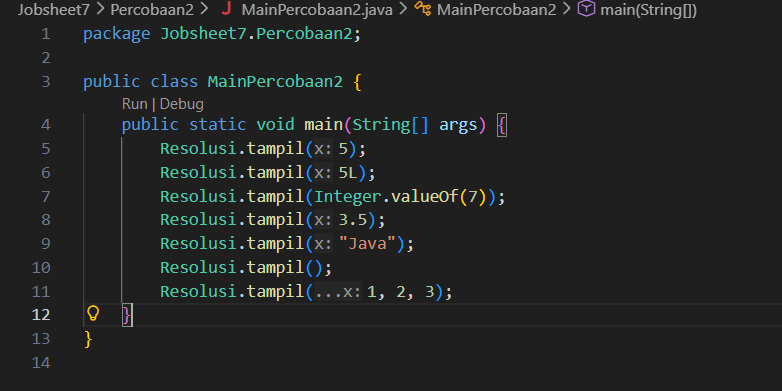
> 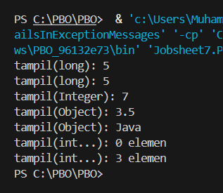

✅ Checkpoint: output berturut-turut: tampil(long) : 5, tampil(long) : 5,
tampil(Integer) : 7, tampil(Object) : 3.5, tampil(Object) : Java,
tampil(int...) : 0 elemen, tampil(int...) : 3 elemen.
> 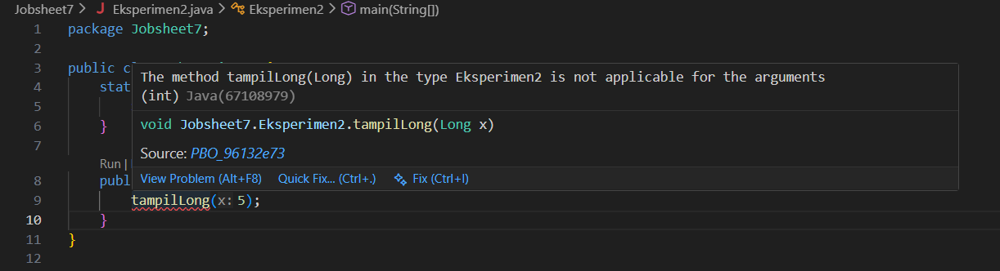
📘 Catatan Konsep: Pesan error: incompatible types: int cannot be converted to Long.
Java tidak mengizinkan widening dilanjutkan boxing (int ke long ke Long), tetapi mengizinkan boxing
dilanjutkan widening (int ke Integer ke Object). Java juga tidak dapat meng-widening antar wrapper
(mis. Integer ke Long).

### Pertanyaan
1. Mengapa tampil(5) memilih tampil(long) dan bukan tampil(Integer), padahal 5 dapat di-boxing? Sebutkan fase yang menentukan.
2. Jelaskan perpindahan overload pada tiap baris tabel Langkah 3.
3. Mengapa tampilLong(5) gagal, sedangkan tampil(5) dapat berakhir pada tampil(Object) bila overload lain dikomentari?
4. Tantangan. Tanpa menjalankan, prediksi output Resolusi.tampil((short) 3) dan Resolusi.tampil('A'), lalu buktikan

### Jawaban
1. Karena compiler mengeksekusi fase pertama terlebih dahulu, yaitu identitas dan widening (di mana int bisa langsung diperlebar menjadi long). Boxing baru dilakukan pada fase berikutnya jika tidak ada metode yang cocok pada fase pertama.
2. Penjelasan:
- Semua aktif: menggunakan widening (tampil(long)).
- tampil(long) dikomentari: menggunakan boxing (tampil(Integer)).
- tampil(long) & tampil(Integer) dikomentari: menggunakan boxing lalu widening ke superclass (tampil(Object)).
- tampil(long), tampil(Integer), & tampil(Object) dikomentari: beralih ke fase terakhir yaitu varargs (tampil(int...)).
3. Java tidak mengizinkan kombinasi widening dilanjutkan boxing (int ke long ke Long). Sebaliknya, Java mengizinkan boxing dilanjutkan widening (int ke Integer ke Object).
4. Prediksi:
- Resolusi.tampil((short) 3) memanggil tampil(long) karena tipe short mengalami widening ke long.
- Resolusi.tampil('A') memanggil tampil(long) karena tipe char mengalami widening ke long (maupun int jika ada, tetapi dalam set overload ini langsung ke long).

## Percobaan 3
> 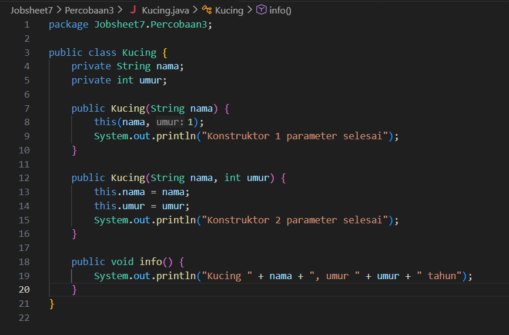
> 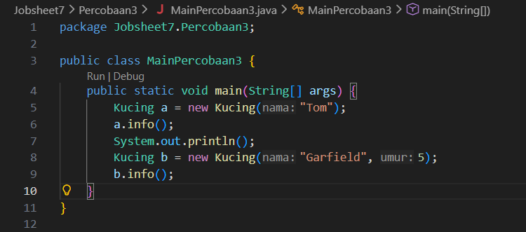
> 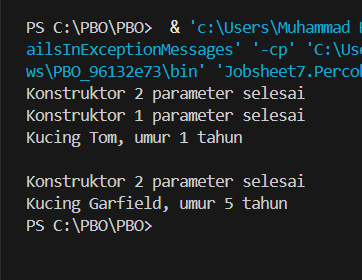
Jika pada main diubah menjadi Kucing c = new Kucing();, maka pesan error yang muncul adalah:
Pesan Error: no suitable constructor found for Kucing (no arguments)

### Pertanyaan
1. Mengapa Konstruktor 2 parameter selesai tercetak lebih dulu daripada Konstruktor 1 parameter selesai pada new Kucing("Tom")?
2. Apa keuntungan this(nama, 1) dibandingkan menyalin isi konstruktor kedua kekonstruktor pertama?
3. Tambahkan public Kucing() yang memanggil this("Tanpa Nama") dan mencetakKonstruktor 0 parameter selesai. Tuliskan output new Kucing() serta urutan ketiga konstruktor dijalankan.

### Jawaban
1. Karena pada konstruktor 1 parameter, baris pertama memanggil this(nama, 1) yang mengeksekusi konstruktor 2 parameter terlebih dahulu hingga selesai, baru kemudian kembali melanjutkan baris sisa di konstruktor 1 parameter.
2. Menghindari duplikasi kode (code duplication) sehingga pemeliharaan kode menjadi lebih terpusat dan mudah diubah.
3. Tambahan public Kucing(): 
- Output new Kucing(): Akan mencetak Konstruktor 2 parameter selesai, Konstruktor 1 parameter selesai, lalu Konstruktor 0 parameter selesai (jika memanggil this("Tanpa Nama") yang berantai ke constructor 2 parameter).
- Urutan eksekusi: Konstruktor 2 parameter --> Konstruktor 1 parameter -->Konstruktor 0 parameter.

## Percobaan 4
> 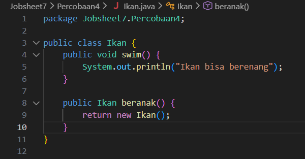
> 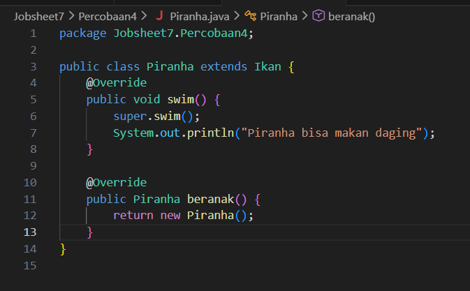
> 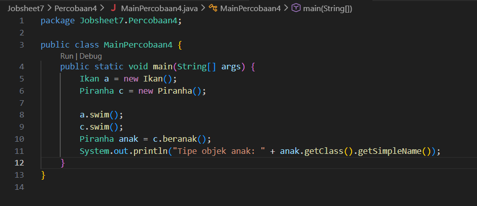
> 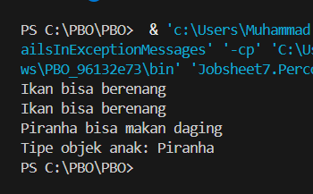
Hapus public pada swim() di PiranhaPesan error: attempting to assign weaker access privileges; was public   
Tambahkan final pada swim() di Ikan (public final void swim())Pesan error: overridden method is final   
Ubah swim() di Piranha menjadi swim(int jarak) dengan @Override tetap adaPesan error: method does not override or implement a method from a supertype   
Tambahkan throws Exception pada swim() di PiranhaPesan error: overridden method does not throw Exception

### Pertanyaan
1. Bandingkan a.swim() dan c.swim(). Apa peran super.swim(), dan apa yang tercetak bila baris itu dihapus?
2. Apa manfaat covariant return pada beranak()? Apakah Piranha anak = a.beranak(); valid? Mengapa?
3. Untuk tiap baris tabel Langkah 4, sebutkan aturan overriding yang dilanggar.
4. Pada baris ketiga tabel, apa yang terjadi bila @Override dihapus? Apakah swim(int) overriding atau overloading?
5. Tantangan. Jika swim() di Ikan dibuat private dan Piranha memiliki @Override public void swim(), apa yang terjadi? Mengapa?

### Jawaban
1. a.swim() memanggil method swim() milik class Ikan, sedangkan c.swim() memanggil method swim() hasil override di Piranha. super.swim() berfungsi memanggil method swim() milik class induk (Ikan) di dalam method override anak. Jika dihapus, teks "Ikan bisa berenang" tidak akan tercetak, dan hanya mencetak "Piranha bisa makan daging".
2. Manfaat covariant return adalah memungkinkan method override mengembalikan tipe data subclass dari tipe kembalian aslinya. Valid, karena c.beranak() mengembalikan objek Piranha sehingga tidak perlu proses casting manual.
3. Aturan overriding yang dilanggar: 
- Menghapus public: Melanggar aturan akses (tidak boleh memperlemah hak akses).
- Menambahkan final di induk: Melanggar aturan bahwa method final tidak bisa di-override.
- Mengubah parameter (swim(int jarak)): Melanggar kesamaan signature method.
- Menambah throws Exception: Melanggar aturan checked exception yang tidak dideklarasikan di method induk.
4. Kode akan lolos kompilasi karena dianggap melakukan overloading (bukan overriding), sehingga c.swim() tanpa parameter akan kembali menjalankan versi milik Ikan.
5. Jika swim() di Ikan bersifat private, maka class Piranha tidak mewarisi method tersebut, sehingga @Override public void swim() tidak dianggap meng-override method induk melainkan membuat method baru di Piranha.

## Percobaan 5
> 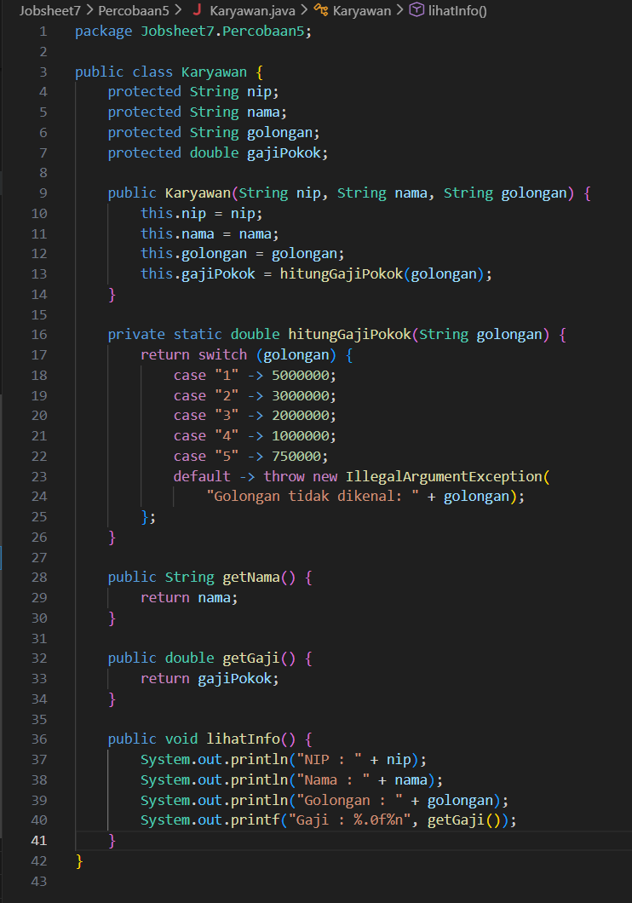
> 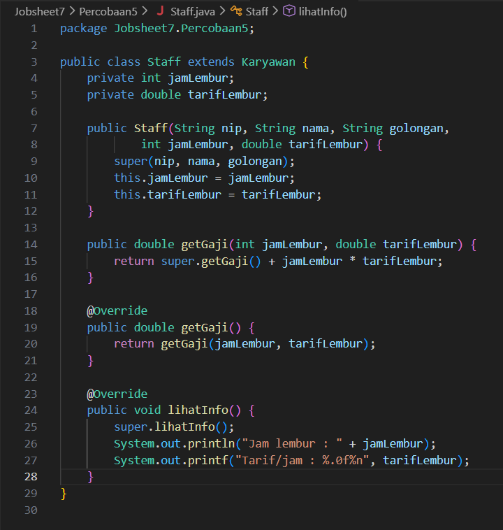
> 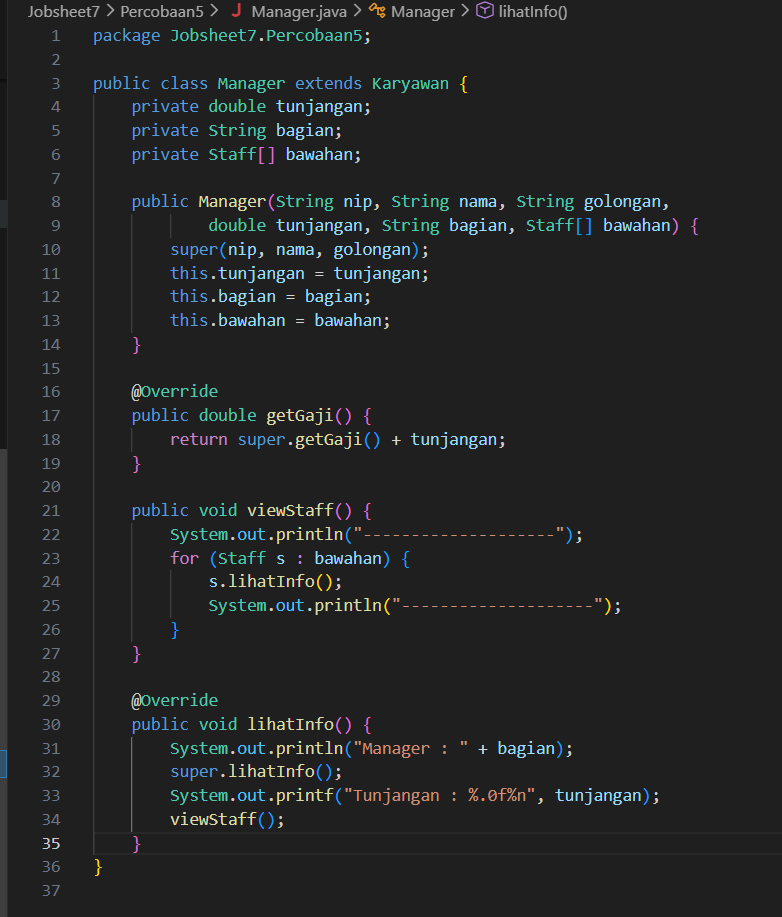
> 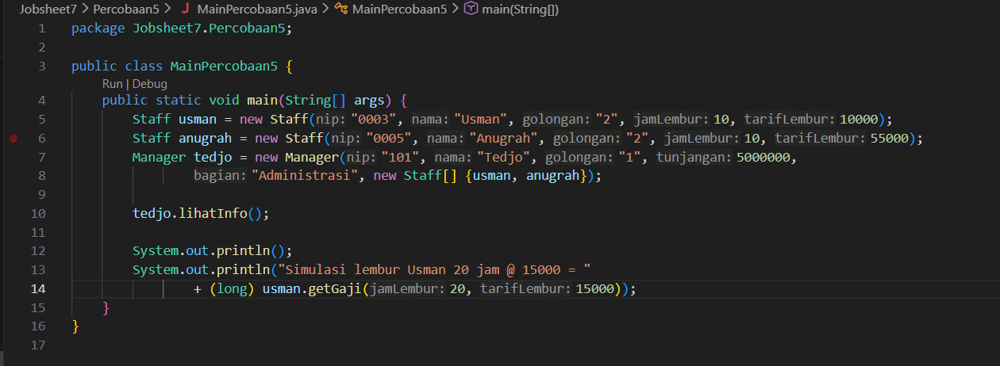
> 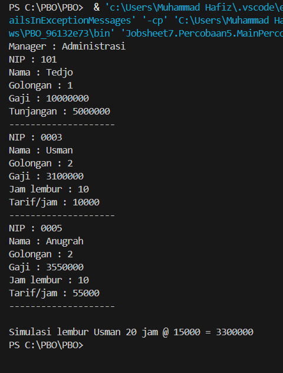

### Pertanyaan
1. Tunjuk method yang termasuk overloading dan yang termasuk overriding pada ketiga class
(sebutkan class dan signature-nya), dan jelaskan pembeda masing-masing.
2. Mengapa getGaji(int, double) memakai super.getGaji(), sedangkan getGaji() pada
Staff memanggil getGaji(jamLembur, tarifLembur)? Apa yang terjadi bila isi
getGaji(int, double) diganti return getGaji() + jamLembur * tarifLembur;?
3. Apa akibatnya pada gaji Staff bila getGaji() di Staff ditulis return jamLembur *
tarifLembur;? Apakah gaji Manager ikut berubah?
4. Apa hubungan Manager dengan Staff (is-a atau has-a)? Tunjuk atributnya dan bandingkan
dengan hubungan Manager dengan Karyawan.

### Jawaban
1. Method Overloading dan Overriding:
- Overloading: getGaji(int, double) pada class Staff (memiliki nama sama dengan getGaji() di Karyawan, tetapi parameternya berbeda).
- Overriding: getGaji() dan lihatInfo() pada class Staff serta class Manager (memiliki signature yang sama persis dengan class induknya).
2. getGaji(int, double) membutuhkan gaji pokok dasar dari induknya (Karyawan), sehingga memanggil super.getGaji(). Sedangkan getGaji() tanpa parameter memanggil method overload-nya sendiri dengan mengirimkan atribut instans (jamLembur dan tarifLembur). Jika diubah menjadi return getGaji() + ..., maka akan terjadi rekursi tak terbatas (infinite recursion).
3. Gaji pokok dasar dari karyawan/golongan tidak akan dihitung, sehingga total gaji Staff hanya bernilai dari uang lemburnya saja. Gaji Manager tidak ikut berubah karena Manager mewarisi dari Karyawan dan memiliki implementasi getGaji() sendiri yang independen.
4. Hubungan Manager:
- Manager dengan Karyawan adalah is-a (pewarisan / inheritance), ditandai dengan extends Karyawan.
- Manager dengan Staff adalah has-a (agregasi), ditandai dengan atribut Staff[] bawahan.

## Tugas
Tugas 1:
(a) Apakah perbedaan tipe kembalian yang membuat keliling(3, 4, 5) dan keliling(3, 4) sah sebagai overloading?
Tidak, tipe kembalian bukan penentu atau pembeda dalam overloading. Yang membuatnya sah adalah jumlah dan tipe parameter yang berbeda (method pertama menerima 3 parameter int, sedangkan method kedua menerima 2 parameter int).

(b) Apa yang terjadi bila t.keliling(3, 4.0) dipanggil?
Akan terjadi error kompilasi (no suitable method found for keliling(int,double)). Alasannya karena tidak ada versi method keliling yang menerima parameter (int, double), dan compiler tidak otomatis melakukan widening atau konversi ke tipe parameter yang ada jika tidak ada tanda tangan (signature) yang cocok secara tepat.

Tugas 2: 
(a) Mengapa bernafas() pada objek Mahasiswa mencetak teks milik Manusia, sedangkan makan() tidak?
Karena Mahasiswa tidak mendeklarasikan ulang (meng-override) method bernafas(), sehingga secara otomatis mewarisi perilaku dari class induknya (Manusia). Sebaliknya, Mahasiswa meng-override method makan(), sehingga method miliknya sendiri yang dieksekusi.

(b) Bandingkan hasil makan() pada Dosen dan Mahasiswa, lalu jelaskan peran super.makan().
Method makan() pada Dosen mengeksekusi super.makan() terlebih dahulu (mencetak "Manusia makan nasi") sebelum mencetak kalimat tambahan khas Dosen. Sedangkan pada Mahasiswa, super.makan() tidak dipanggil, sehingga teks dari class induk tidak dimunculkan sama sekali dan digantikan sepenuhnya oleh perilaku baru di Mahasiswa.

Tugas 3:
Aspek: 
- Lokasi terjadi
- Signature (parameter)
- Tipe kembalian
- Access modifier
- Peran @Override

Overloading:
- Di dalam satu class yang sama, atau antara class induk dan anak
- Harus berbeda (jumlah, tipe, atau urutan parameter)
- Boleh sama atau berbeda (bukan pembeda)
- Bebas / tidak terikat aturan khusus
- Tidak digunakan

Overriding
- Harus melibatkan relasi pewarisan (inheritance) antara class induk dan class anak
- Harus sama persis
- Harus sama atau berupa tipe turunan (covariant return)
- Tidak boleh lebih ketat (weaker access) dari method induknya
- Opsional secara teknis, tetapi sangat dianjurkan untuk validasi compiler

2. Kapan Memilih Overloading dan Kapan Overriding?
- Overloading dipilih ketika kita ingin membuat beberapa versi method dengan nama yang sama guna menerima variasi input/argumen yang berbeda untuk fungsi yang sem਼isalnya (Contoh dari jobsheet: method kali(...) atau keliling(...) pada class Segitiga).   
- Overriding dipilih ketika kita ingin mengubah atau memberikan implementasi spesifik pada method yang diwarisi dari class induk agar sesuai dengan perilaku subclass-nya (Contoh dari jobsheet: method makan() pada class Dosen dan Mahasiswa).
3. Mengapa Method static, private, dan final Tidak Dapat Di-override?
- private: Method bersifat privat dan terenkapsulasi secara ketat di dalam class asalnya, sehingga subclass tidak dapat melihat atau mengaksesnya untuk dilakukan override.
- static: Method terikat pada tingkat class (class-level), bukan objek instans, sehingga resolusinya ditentukan saat waktu kompilasi (compile-time) melalui method hiding, bukan melalui polimorfisme runtime.
- final: Kata kunci final secara eksplisit melarang suatu method untuk diubah atau diturunkan implementasinya lebih lanjut oleh class anak.